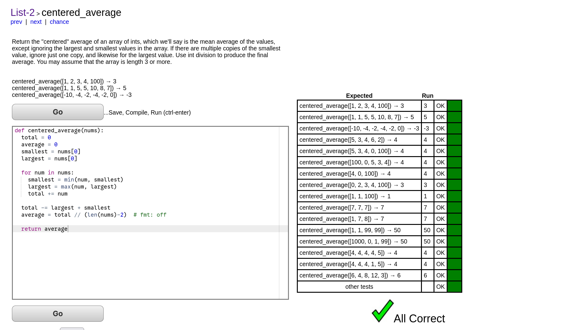

<div align="center">

## codingbat-python

Solutions to [CodingBat Python](https://codingbat.com/python) problems

|  |
| :-----------------------------: |

</div>

#

### Structure

```text
.
├── 01-warmup-1
│   ├── 01-sleep_in.py
│   ├── 02-monkey_trouble.py
│   ├── 03-sum_double.py
│   └── ...    (other problems)
└── ...    (other sections)
```
